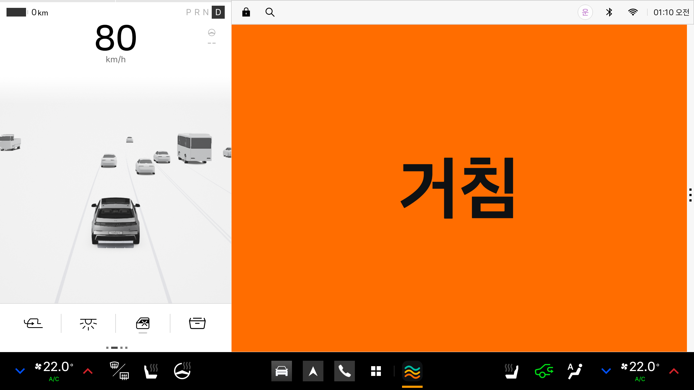
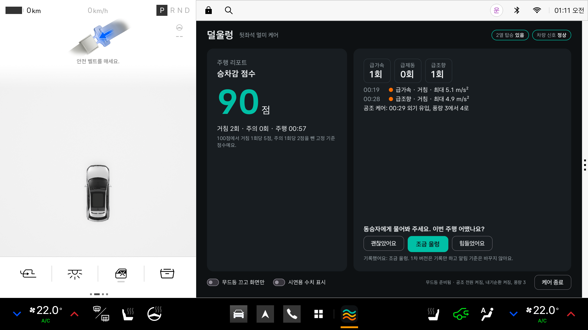
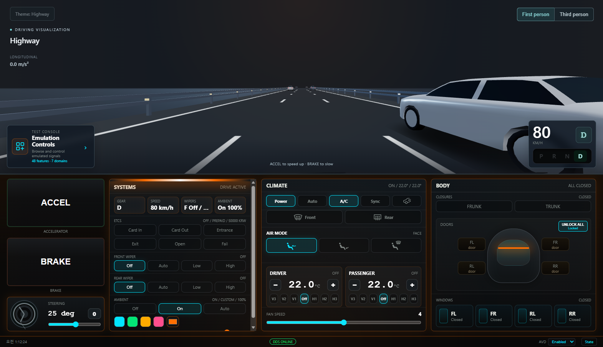
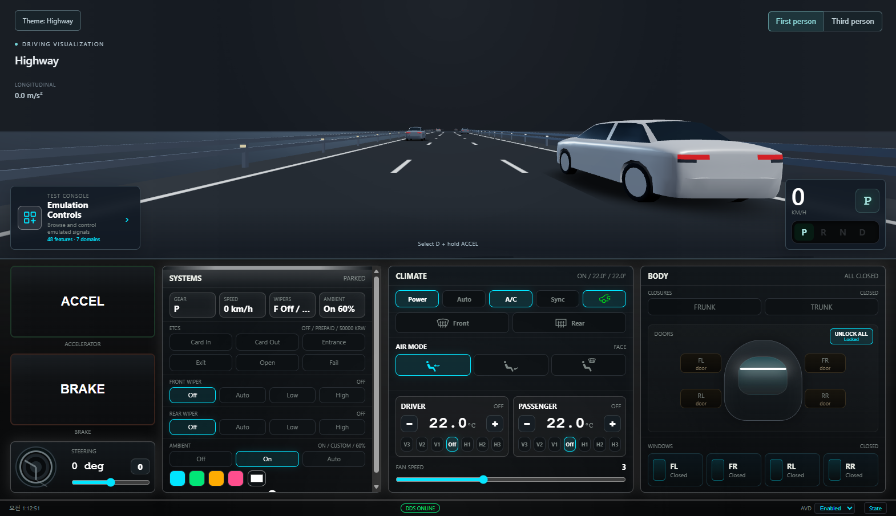

# 덜울렁

차속과 핸들각으로 뒷좌석에 전해지는 흔들림을 추정해 실내 무드등 색으로 알려 주고, 운전자가 동승자를 배려해 부드럽게 운전하도록 돕는 뒷좌석 멀미 케어 코치 앱

현대자동차그룹 차량용 앱 개발 공모전(Pleos Connect) 1차 제출물입니다. Android Automotive OS 기반 Pleos Connect Emulator에서 동작합니다.

| 주행 중: 단계 색과 한 단어 | 정차 후: 주행 리포트 |
|---|---|
|  |  |
| **Virtual Console: 무드등(진한 주황), 공조 케어(외기 유입, 풍량 4)** | **Virtual Console: 정차 후 원래 설정으로 복원(흰색 60%, 내기순환, 풍량 3)** |
|  |  |

무드등 색은 에뮬레이터 화면이 아니라 **Virtual Console 화면**(SYSTEMS 칸의 AMBIENT 색, 패널 테두리, BODY 칸의 실내등 막대)에 표시됩니다.

## 1차 구현 범위와 2차 예정 범위

기획서 3번의 표시와 같습니다.

| 기능 | 1차 데모(이 저장소) | 2차 PT 예정 |
|---|---|---|
| ① 흔들림 추정 | 차속 변화율로 앞뒤, 핸들각으로 좌우 가속도 계산. 순간 흔들림 3단계, 멀미 부하. 비현실 값 버리기, 신호 끊김 시 '신호 확인 중' | 차종별 조향비·축거 보정, 흔들림 빠르기 반영 |
| ② 무드등 알림 | 잔잔함 청록, 주의 호박, 거침 진한 주황(빨강 안 씀). 단계가 오를 때 짧은 알림음. 원래 설정 복원. '무드등 끄고 화면만' 설정 | |
| ③ 공조 케어 | 기본 동작: 공조가 켜져 있을 때만, 한 주행에 한 번 외기 유입 + 풍량 한 단계. 사용자 조작 우선, 복원 | 예외 처리 강화(터널, 미세먼지 상황 판단) |
| ④ 2열 탑승 감지 | 앱 실행 중 좌석 착좌 센서 구독, 탑승하면 케어 시작. 첫 실행 동의 | 차에 타면 시작되는 자동 실행 |
| ⑤ 급회전 미리 알림 | 없음 | 내비 TBT로 급회전 전 짧은 음성 안내 |
| ⑥ 정차 후 리포트 | 승차감 점수, 급가속·급제동·급조향 횟수와 시점, 피드백 3버튼(기록만) | 주행 추이, 피드백으로 알림 기준 개인화 |

1차 버전은 기록을 메모리에만 둡니다(DB 없음, 앱을 닫으면 사라짐). 피드백은 기록만 하고 알림 기준은 바꾸지 않습니다.

## 테스트 환경

| 항목 | 값 |
|---|---|
| 에뮬레이터 | Pleos Connect Emulator `Pleos_Connect_v2.1.0` (Android 14, API 34, user 빌드) |
| 화면 규격 | 2560 x 1440, 160 dpi. 앱 영역은 오른쪽 약 1680 x 1210 |
| SDK | Pleos Vehicle SDK `ai.pleos.playground:Vehicle:2.3.2`, AAOS Car API(`useLibrary("android.car")`) |
| 앱 | 패키지 `com.motioncare.deolulleong`, minSdk 28, targetSdk 34, Kotlin, Jetpack Compose |
| 차량 신호 입력 | Virtual Console (`adb forward tcp:8088 tcp:8088` 후 브라우저) |

**Virtual Console 페이지를 꼭 열어 두세요.** 콘솔은 브라우저 세션이 없으면(`emulator_inactive`) 앱이 쓴 무드등·공조 값을 차량에 반영하지 않습니다.

## 설치와 권한

release APK: [`apk/덜울렁_release.apk`](apk/덜울렁_release.apk) (서명됨, R8 축소 끔)

```
adb install -r -g apk/덜울렁_release.apk
```

- `-g`는 런타임 권한 `android.car.permission.CAR_SPEED`(차속, dangerous)를 설치 때 허용합니다.
  `-g` 없이 설치하면 첫 실행 때 권한 창이 뜨고, 허용을 누르면 됩니다.
- 나머지 Pleos 권한(`CAR_DRIVE`, `CAR_LIGHTS`, `CONTROL_CAR_LIGHTS`, `CAR_CLIMATE`, `CONTROL_CAR_CLIMATE`, `CAR_SEATS`)은 에뮬레이터에서 모두 normal 권한이라 설치만 하면 허용됩니다.
- 첫 실행 때 "무드등과 공조를 바꿉니다" 동의 화면이 한 번 나옵니다. 동의해야 케어가 시작됩니다.

## 실행 방법

### 사람이 직접 조작할 때

1. 에뮬레이터를 켜고 `adb forward tcp:8088 tcp:8088`, 브라우저로 http://127.0.0.1:8088/ 을 엽니다.
2. 덜울렁을 실행하고 '동의하고 시작'을 누릅니다.
3. 콘솔의 Test Console(Emulation Controls)에서 Seat Occupancy의 Rear left를 탑승으로 바꾸면 케어가 시작되고 무드등이 청록이 됩니다. 앱의 '지금 케어 시작'으로도 시작할 수 있습니다.
4. 기어 D, ACCEL을 길게 누르면 급가속, BRAKE는 급제동, 핸들을 빨리 돌리면 급조향입니다. 무드등과 앱 화면 색이 바뀝니다.
5. 기어 P로 바꾸면 주행이 끝나고 무드등·공조가 원래대로 돌아가며 리포트가 나옵니다.

### 시연 대본으로 실행할 때 (영상 녹화용)

콘솔 페이지를 열어 둔 채 스크립트로 속도를 넣으면, 페이지가 자체 물리 계산으로 계산한 속도를 서버에 다시 써서 속도가 튑니다(원인과 측정은 [`docs/evidence/console_jitter_test.txt`](docs/evidence/console_jitter_test.txt)). 그래서 녹화할 때는 **보기 전용 콘솔**을 엽니다.

```
adb forward tcp:8088 tcp:8088
python tools/console_viewer.py            # 브라우저로 http://127.0.0.1:8090/ 을 연다
python tools/drive_scenario.py            # 다른 창에서. 동의·피드백 버튼은 사람이 누른다
python tools/drive_scenario.py --auto-tap # 리허설: 버튼도 스크립트가 누른다
```

보기 전용 콘솔은 원래 페이지를 그대로 중계하면서 페이지의 물리 계산과 속도 쓰기만 끕니다. 무드등 색, 공조, 속도, 핸들 표시는 그대로 보입니다. 시험 결과 원래 페이지에서는 125회 중 22회가 튀었고(최대 33 km/h 차이), 보기 전용 콘솔에서는 0회였습니다.

대본(약 80초)과 release APK에서 실제로 나온 결과([`docs/evidence/release_demo_timeline.txt`](docs/evidence/release_demo_timeline.txt)):

| 장면 | 콘솔 입력 | 앱 결과 |
|---|---|---|
| 1 동의 | 기어 P | 동의 화면, '동의하고 시작' |
| 2 2열 탑승 | 뒷좌석 왼쪽 탑승 | 케어 시작, 무드등 청록 |
| 3 부드러운 출발 | D, 0에서 40 km/h (약 0.8 m/s²) | 청록 유지 |
| 4 급가속 | 40에서 80 km/h, 2.5초 (약 4.4 m/s²) | 0.4초 안에 호박, 진한 주황, 알림음 |
| 5 회복 | 80 km/h 유지 | 약 1.7초 뒤 청록 |
| 6 급조향 | 80 km/h, 핸들 0에서 25도 | 0.6초 안에 진한 주황. 멀미 부하 4초 넘어 공조 케어(외기 유입, 풍량 3에서 4) |
| 7 공조 확인 | 직진 | 콘솔 CLIMATE 칸 바뀐 값 확인 |
| 8 정차 | 80에서 0 km/h (약 1.4 m/s²), 기어 P | 무드등 흰색 60%, 내기순환, 풍량 3으로 복원 |
| 9 리포트 | | 승차감 90점, 거침 2회, 급가속 00:19, 급조향 00:28, 공조 케어 00:29 |
| 10 피드백 | | '조금 울렁' 기록 |

`--with-brake`를 붙이면 정차 끝에 급제동을 넣습니다. `--shots DIR`은 장면별 화면을 저장합니다.

## 흔들림 계산 명세

코드 [`ShakeEstimator.kt`](app/src/main/java/com/motioncare/deolulleong/ShakeEstimator.kt) 주석과 같은 내용입니다.

처리 순서: **원신호 유효성 검사 → 추정 → 필터 → 표시용 범위 제한**

1. 원신호 유효성 검사
   - 차속 0~70 m/s, 핸들각 -470~500도 밖의 값은 그 샘플을 통째로 버립니다.
2. 추정
   - 앞뒤 가속도: 0.5초 구간 차속 차분 (지금 차속 - 0.5초 전 차속) / 경과 시간.
     차분 결과 |a| > 12 m/s²이면 신호 이상으로 보고 버립니다(이동평균에 넣지 않음).
   - 좌우 가속도: v² · tan(핸들각 ÷ 조향비) / 축거. 조향비 15, 축거 2.95 m (상수).
3. 필터
   - 앞뒤, 좌우 모두 3샘플 이동평균(0.1초 주기, 0.3초).
   - 순간 흔들림 = √(앞뒤² + 좌우²)
   - 단계: 2.0 m/s² 미만 잔잔함, 2.0 이상 주의, 3.0 이상 거침.
     올라갈 때는 바로 올리고, 내려갈 때는 낮은 단계가 1.5초 이어져야 내립니다.
4. 표시용 범위 제한
   - 화면과 로그의 좌우 가속도는 ±9.8 m/s²에서 자릅니다. 단계 판정은 자르기 전 값으로 합니다.

멀미 부하: 최근 N초 동안 순간 흔들림이 주의 이상(2.0 m/s² 이상)이었던 시간의 합. 기준을 넘으면 공조 케어를 합니다.

차량 신호(차속, 핸들각)가 2초 넘게 안 오면 모든 제어를 멈추고 무드등·공조를 되돌린 뒤 화면에 '신호 확인 중'을 띄웁니다.

### 상수와 데모용 값

| 상수 | 값 | 비고 |
|---|---|---|
| `STEERING_RATIO` | 15 | 가정값. 차종별 실제 조향비는 확인 안 됨 |
| `WHEELBASE_M` | 2.95 m | CarInfo에 축거 API가 없어 상수 |
| `DV_WINDOW_MS`, `MA_SIZE` | 0.5초, 3샘플 | |
| `LON_ANOMALY_MPS2` | 12 m/s² | 넘으면 신호 이상 |
| `CAUTION_MPS2`, `ROUGH_MPS2` | 2.0, 3.0 m/s² | |
| `LEVEL_DOWN_HOLD_MS` | 1.5초 | |
| `LAT_DISPLAY_LIMIT_MPS2` | 9.8 m/s² | 표시용 |
| `LOAD_WINDOW_MS` (N) | **60초 (데모용 값)** | 실제 주행용 값은 2차에서 정함(기획: 최근 몇 분) |
| `LOAD_TRIGGER_MS` | **4초 (데모용 값)** | 1분 남짓한 시연에서 급가속 + 급조향으로 넘도록 짧게 둠 |
| `SIGNAL_TIMEOUT_MS` | 2초 | |

## 케어 동작 규칙

- **케어 시작**: 동의 + 2열 탑승(1초 이상 유지된 값) 또는 '지금 케어 시작'.
- **주행**: 주행 상태(`CarUxRestrictions.requiresDistractionOptimization`, 기어 D에서 true)일 때 0.1초마다 계산합니다. 화면은 단계 색과 한 단어(잔잔/주의/거침)만 크게 보여 줍니다.
- **주행 종료**: 기어 P(requiresDO=false)가 되면 무드등·공조를 되돌리고 리포트를 보여 줍니다. 다시 출발하면 새 주행입니다.
- **무드등 복원**: 케어를 시작할 때 스위치·밝기·색을 저장하고 스위치 켜기, 밝기 100으로 바꿉니다. 주행 종료, '케어 종료' 버튼, 앱 종료(onDestroy), 신호 끊김 때 저장한 값으로 되돌립니다.
- **공조 케어**: 공조 전원이 켜져 있을 때만, 멀미 부하가 기준을 넘으면 한 주행에 한 번 `setHvacRecirculation(false)`(외기 유입)와 풍량 +1을 합니다(최대 8). 바꾸기 직전 값을 저장해 두고 위와 같은 때에 되돌립니다. 바꾼 뒤 사용자가 공조를 바꾸면 그 주행에서는 더 건드리지 않고 복원도 하지 않습니다(사용자 설정 우선).
- **승차감 점수**: 100 - 거침 구간 수 × 5 - 주의 구간 수 × 2, 0점 아래로 내려가지 않습니다. 한 구간은 잔잔함을 벗어났다가 돌아올 때까지이고, 구간의 최고 단계로 셉니다. 최고점에서 좌우가 크면 급조향, 아니면 앞뒤 부호로 급가속/급제동입니다.

## 사용 API와 권한

| 기능 | API | 권한 |
|---|---|---|
| 차속 | AAOS `CarPropertyManager` `PERF_VEHICLE_SPEED` (m/s, 약 10 Hz) | `android.car.permission.CAR_SPEED` (dangerous) |
| 핸들각 | `SteeringWheel.getCurrentSteeringWheelAngle` (0.1초 주기 조회) | `pleos.car.permission.CAR_DRIVE` |
| 무드등 | `Light.get/setAmbientLightSwitch`, `get/setAmbientLightBrightness`, `get/setAmbientLightBrightnessColor` | `CAR_LIGHTS`, `CONTROL_CAR_LIGHTS` |
| 공조 | `HVAC.getHvacPowerState`, `get/setHvacRecirculation`, `get/setHvacFanSpeed`와 각 리스너 | `CAR_CLIMATE`, `CONTROL_CAR_CLIMATE` |
| 2열 탑승 | `Seat.getCurrentSeatOccupancy`, `registerSeatOccupancy` (ROW_2_LEFT/CENTER/RIGHT) | `CAR_SEATS` |
| 주행 상태 | AAOS `CarUxRestrictionsManager` | 없음 |
| 알림음 | `ToneGenerator` (TTS 아님) | 없음 |

Pleos 권한은 모두 `pleos.car.permission.` 접두어이며, 에뮬레이터에서 normal 권한으로 확인했습니다. 각 도메인은 `check...Capabilities`로 지원 영역을 먼저 확인하고 그 영역을 그대로 씁니다.

## 시험 결과

- 시연 대본: release APK를 새로 설치해 실행, 위 표와 같이 동작([`docs/evidence/release_demo_timeline.txt`](docs/evidence/release_demo_timeline.txt), 화면 [`docs/screens/`](docs/screens)).
- 예외 동작 17항목 모두 통과([`docs/evidence/edge_tests_debug.txt`](docs/evidence/edge_tests_debug.txt), `python tools/edge_tests.py`):
  케어 종료 버튼 복원, 종료 뒤 자동 재시작 안 함, '무드등 끄고 화면만' 켜고 끄기, 신호 끊김 때 멈춤·복원·'신호 확인 중'과 복구,
  공조 케어 뒤 사용자 변경 감지와 복원 안 함, 공조 꺼짐 때 건너뜀, 앱 종료(onDestroy) 복원.
- 신호 끊김은 콘솔로 만들 수 없어(콘솔 세션이 없어도 차속 이벤트는 계속 옴) debug 빌드에만 있는 시험용 브로드캐스트로 흉내 냈습니다.
  `adb shell am broadcast -a com.motioncare.deolulleong.TEST_SIGNAL_LOSS --el ms 5000`.
  Android 12부터 뒤로 키는 첫 화면을 끝내지 않아 onDestroy 시험은 `TEST_FINISH` 브로드캐스트로 했습니다. release 빌드에는 이 훅이 없습니다.
- 알림음: 단계가 오를 때 ToneGenerator가 AudioTrack으로 소리를 내보내는 것을 앱 로그로 확인했습니다. 에뮬레이터 소리가 PC 스피커로 나오는지는 PC 설정에 따릅니다.

이 시험은 규칙이 의도대로 동작하는지 확인한 것이며, 실제 승차감이나 멀미 개선 효과를 검증한 것은 아닙니다.

## 알려진 한계

- **2열 탑승 값 반전**: 이 에뮬레이터(v2.1.0)와 Vehicle SDK 2.3.2 조합에서 SeatOccupancy Boolean이 실제와 반대로 나옵니다(VHAL 원시값은 정상). 그래서 보정 상수 `SEAT_OCCUPANCY_EMULATOR_INVERT = true`를 둡니다(에뮬레이터 관찰 보정, 원인 확인 중). 실차나 고쳐진 버전에서는 false로 바꿉니다.
- **좌우 가속도는 운동학 추정값**입니다. 타이어 미끄럼을 무시하고 조향비 15를 가정해 큰 핸들각에서 실제보다 크게 나옵니다. 그래서 표시값을 ±9.8에서 자릅니다.
- **주행 중 화면 차단**: 이 에뮬레이터에서는 distractionOptimized 메타데이터가 없어도 화면이 막히지 않았습니다. 덜울렁은 주행 상태를 읽어 스스로 화면을 단계 색과 한 단어로 줄입니다. 메타데이터는 넣어 두었습니다.
- 무드등 색은 에뮬레이터 화면이 아니라 Virtual Console 화면에만 보입니다.

## 빌드

```
# JDK 21 사용 (Android Studio 내장 JBR 25는 Gradle 8.13과 맞지 않음)
./gradlew assembleDebug
./gradlew assembleRelease
```

- Pleos SDK는 Gradle 의존성으로만 받습니다(`settings.gradle.kts`의 `https://nexus-playground.pleos.ai/repository/maven-releases/`). SDK 바이너리는 저장소에 없습니다.
- release 서명 정보는 저장소 밖 파일(`~/.motioncare/keystore.properties`, 또는 환경변수 `DEOL_KEYSTORE_PROPS`)에서 읽습니다. 파일이 없으면 서명 없는 release가 만들어집니다.

## 저장소 구성

| 경로 | 내용 |
|---|---|
| `app/src/main/java/com/motioncare/deolulleong/` | `ShakeEstimator.kt`(계산 명세, 상수), `CareEngine.kt`(케어 흐름), `CarIo.kt`(무드등·공조·좌석), `Trip.kt`(기록, 점수), `Ui.kt`(Compose 화면), `MainActivity.kt` |
| `apk/` | 서명된 release APK |
| `tools/console_viewer.py` | 보기 전용 콘솔 프록시(녹화용) |
| `tools/drive_scenario.py` | 시연 대본과 타임라인 |
| `tools/edge_tests.py` | 예외 동작 시험 |
| `tools/console_jitter_test.py` | 콘솔 속도 튐 시험 |
| `docs/screens/`, `docs/evidence/` | 화면과 시험 근거 |
| `SPIKE_RESULT.md`, `spike_evidence/` | 기획 전 기술 확인 보고서와 근거. 시험 앱 코드는 git 태그 `spike` |
